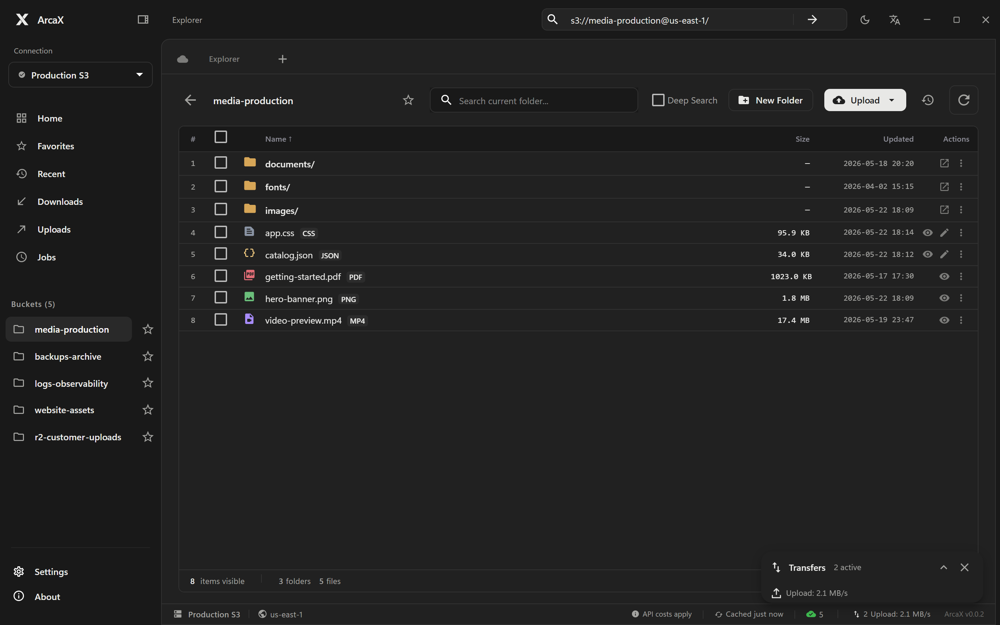
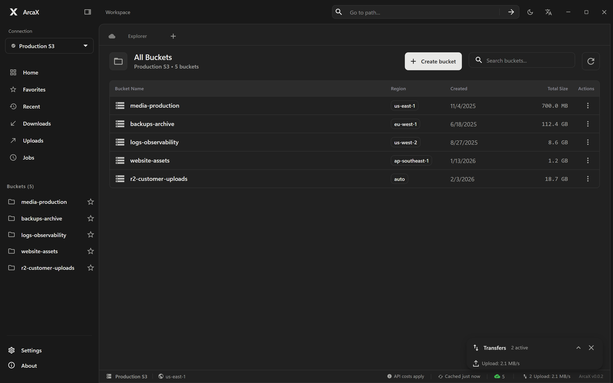
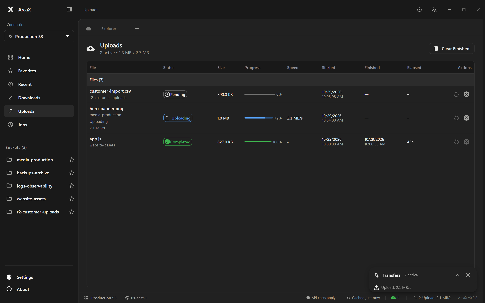
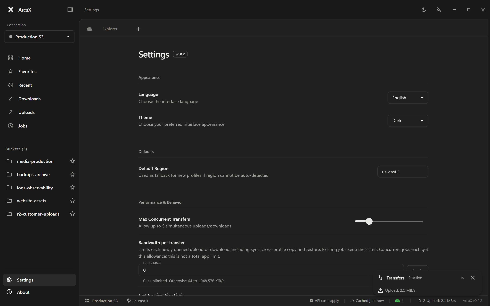

<p align="center">
  
</p>

<h1 align="center">ArcaX</h1>

<p align="center">
  <strong>A fast, focused desktop client for Amazon S3 and S3-compatible object storage.</strong><br>
  Rust core · Tauri shell · Next.js interface
</p>

<p align="center">
  <a href="https://github.com/TreeX-xx/ArcaX/releases/latest"></a>
  <a href="LICENSE"></a>
  
  
</p>

<p align="center">
  <a href="https://github.com/TreeX-xx/ArcaX/releases/latest"><b>Download for Windows</b></a> ·
  <a href="https://github.com/TreeX-xx/ArcaX/issues">Issues</a> ·
  <a href="#documentation">Documentation</a>
</p>

<p align="center">
  
</p>

**ArcaX** pairs a Rust core with a Tauri shell and a Next.js frontend: prefix-aware navigation, a virtualized object table, local caching, previews, and transfer controls for large buckets. Credentials stay in the OS keychain, and every S3 request is made by the local backend.

## Screenshots

<p align="center">
  
  
</p>

<p align="center">
  
</p>

## What is different in ArcaX

- **New brand and theme** — ArcaX naming, app icon, and a graphite workspace, collapsible sidebar, integrated window controls, and a monochrome X mark.
- **Bilingual interface** — English and Simplified Chinese can be switched from Settings or the top bar, and follow the OS language on first run.
- **Updated column** — the object table shows a local `YYYY-MM-DD HH:mm` timestamp for files and, where S3 exposes it, for folders too.
- **Automatic updates not configured** — update manually from ArcaX GitHub Releases.

Folder timestamps are derived from the newest direct child object, with a fallback to a zero-byte folder marker. S3 prefixes have no timestamp of their own, so folders without children or markers show `—`.

## Features

### Browsing

- Prefix-aware folder navigation with breadcrumbs and direct `s3://bucket/prefix` access.
- Cached bucket discovery per profile, deep recursive search, and bounded complete-result sorting.
- Virtualized object table for large listings, with client-side filtering.
- Bucket favorites and multiple tabs.

### Files and transfers

- Upload, download, copy, move, and delete files or recursive folders.
- Large multipart uploads with adaptive part sizing and cancellation.
- Local-folder-to-S3 sync preview, cross-profile copy, and saved/scheduled sync jobs.
- Transfer queue with concurrency and bandwidth controls.
- Presigned URLs, public URL patterns, and guarded URL imports.
- Object properties, content-type editing, ACLs, and version history.

### Previews and profiles

- Image, audio, video, and PDF previews through presigned URLs.
- Monaco editor for text, JSON, YAML, and code, with an editable preview size limit.
- Multiple S3 profiles with secure credential storage in the OS keychain.
- AWS profile discovery and SSO login support.

## Install

Download the latest Windows x64 installers from [GitHub Releases](https://github.com/TreeX-xx/ArcaX/releases/latest):

| File | Description |
| --- | --- |
| `ArcaX_<version>_x64_en-US.msi` | WiX MSI installer |
| `ArcaX_<version>_x64-setup.exe` | NSIS installer with English/Chinese language selection |
| `SHA256SUMS.txt` | Checksums for both installers |

The installers are unsigned, so Windows SmartScreen may warn. They use the WebView2 download bootstrapper: internet access is only needed when WebView2 is not already present. macOS and Linux builds are not published; run `pnpm tauri build` on those systems to produce them locally.

## Requirements

- Node.js 22 or newer
- pnpm 11 (`corepack enable` or `npm install -g pnpm@11.2.2`)
- Rust stable with the MSVC toolchain on Windows
- Visual Studio Build Tools with the C++ workload (Windows) or Xcode command line tools (macOS)

## Development

```bash
git clone https://github.com/TreeX-xx/ArcaX.git
cd ArcaX
pnpm install --frozen-lockfile
pnpm tauri dev    # starts Next.js on port 3001 and the desktop shell
```

For frontend-only development, run `pnpm dev` instead. Do not start both commands on port 3001.

## Build and test

```bash
pnpm build        # static frontend build
pnpm typecheck    # TypeScript
pnpm test:frontend
pnpm test:rust    # cargo test --manifest-path src-tauri/Cargo.toml
pnpm test:smoke   # build + Playwright
```

README screenshots are generated from the static build with a mocked desktop backend:

```bash
pnpm build
pnpm screenshots:readme
```

## Distribution

ArcaX is built locally. Run `pnpm tauri build` for installers, then publish the resulting artifacts to [GitHub Releases](https://github.com/TreeX-xx/ArcaX/releases). The manually triggered **Desktop packages** GitHub Actions workflow can still produce downloadable build artifacts but does not publish releases. See [repository and release setup](docs/REPOSITORY.md) and the [release process](.agents/notes/release-process.md).

## License

MIT. See [LICENSE](LICENSE).

## Documentation

- [Repository and release setup](docs/REPOSITORY.md)
- [Design notes](DESIGN.md)
- [Website screenshots](docs/WEBSITE_SCREENSHOTS.md)
- [Folder sync](docs/FOLDER_SYNC.md)
- [Cross-profile copy](docs/CROSS_PROFILE_COPY.md)
- [Scheduled jobs](docs/SCHEDULED_JOBS.md)
- [Transfer controls](docs/TRANSFER_CONTROLS.md)
- [Version history](docs/VERSION_HISTORY.md)
- [Public URLs and imports](docs/PUBLIC_URLS_AND_IMPORTS.md)
- [Testing](docs/TESTING.md)

## Acknowledgments

ArcaX is based on [Brows3](https://github.com/rgcsekaraa/brows3). Thanks to its author; the original MIT copyright notice is preserved in [LICENSE](LICENSE).
