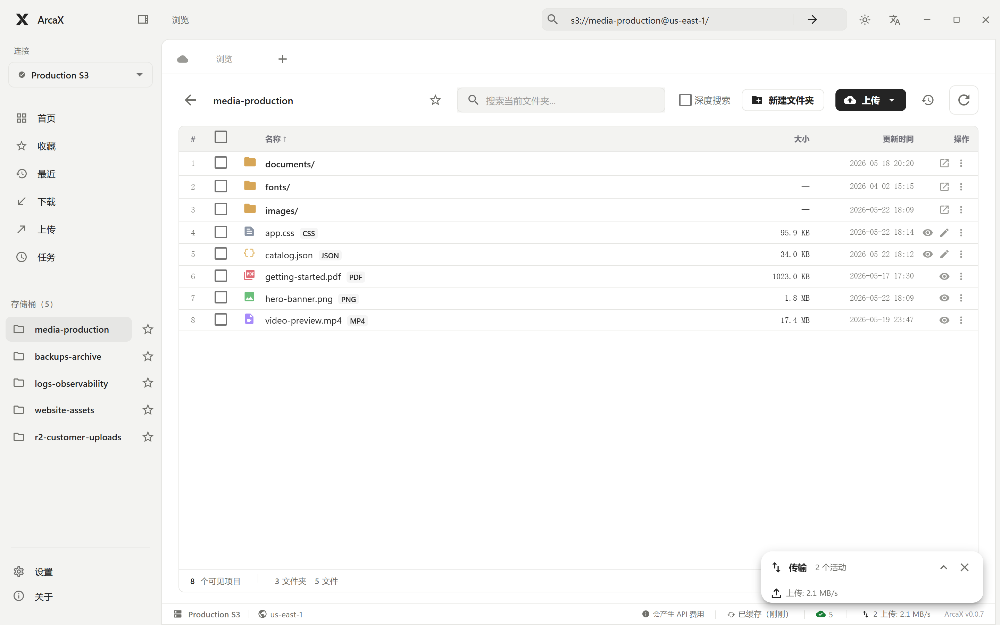
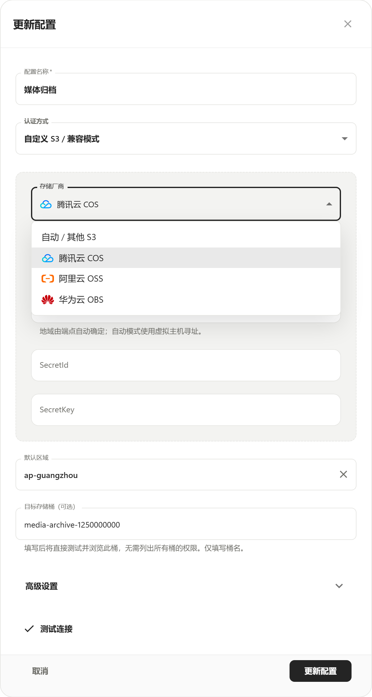
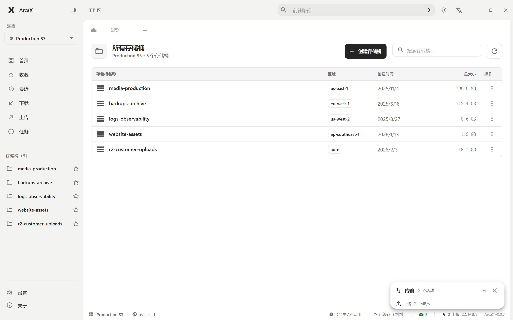
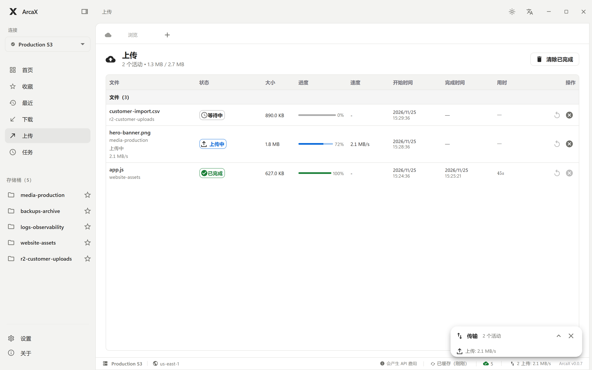
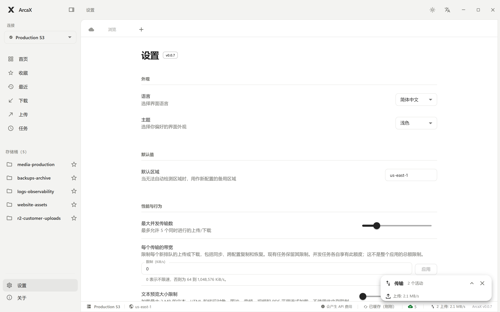

<p align="center">
  
</p>

<h1 align="center">ArcaX</h1>

<p align="center"><strong>简体中文</strong> · <a href="README.en.md">English</a></p>

<p align="center">
  <strong>适用于 Amazon S3 和 S3 兼容对象存储的轻快桌面客户端。</strong><br>
  Rust 核心 · Tauri 桌面框架 · Next.js 界面
</p>

<p align="center">
  <a href="https://github.com/TreeX-xx/ArcaX/releases/latest"></a>
  <a href="LICENSE"></a>
  
  
</p>

<p align="center">
  <a href="https://github.com/TreeX-xx/ArcaX/releases/latest"><b>下载 Windows 版</b></a> ·
  <a href="https://github.com/TreeX-xx/ArcaX/issues">问题反馈</a> ·
  <a href="#文档">文档</a>
</p>

<p align="center">
  
</p>

**ArcaX** 采用 Rust 核心、Tauri 桌面框架和 Next.js 前端，提供基于前缀的导航、虚拟化对象表格、本地缓存、文件预览和传输控制，方便管理大型存储桶。凭据存储在操作系统的钥匙串中，所有 S3 请求均由本地后端发起。

## 国内 S3 兼容云存储

<p> <b>腾讯云 COS</b> ·  <b>阿里云 OSS</b> ·  <b>华为云 OBS</b></p>

在 **自定义 S3 / 兼容模式** 中选择上方任一厂商预设即可自动填入区域端点，也可以粘贴 YAML 或环境变量格式的连接配置。如果账号只获准访问指定存储桶，可填写目标桶后直接测试连接和浏览。各厂商的认证要求和验证进度见 [S3 兼容连接指南](docs/REPOSITORY.md#s3-compatible-connections)。

<p align="center">
  
</p>

## 应用截图

<p align="center">
  
  
</p>

<p align="center">
  
</p>

## ArcaX 特色

- **品牌与主题**。ArcaX 采用独立的应用图标、石墨色工作区和单色 X 标志，支持折叠侧边栏，并将窗口控制集成在顶部栏。
- **双语界面**。首次运行时跟随系统语言，也可在设置或顶部栏切换简体中文和英文。
- **更新时间列**。对象表格以本地时间 `YYYY-MM-DD HH:mm` 显示文件的更新时间。若 S3 提供相关数据，也会显示文件夹的更新时间。
- **手动更新**。新版本可从 ArcaX 的 GitHub Releases 下载并安装。

文件夹的更新时间优先取自最近修改的直接子对象，其次取自零字节文件夹标记。S3 前缀本身没有时间戳，因此缺少子对象和标记的文件夹会显示 `—`。

## 功能

### 浏览

- 按前缀浏览文件夹，支持面包屑导航和直接访问 `s3://bucket/prefix`。
- 按连接配置缓存存储桶列表，支持递归搜索，并在结果数量未超出上限时对完整结果排序。
- 通过虚拟化表格浏览大型对象列表，支持客户端筛选。
- 收藏存储桶，并通过多个标签页切换视图。

### 文件与传输

- 支持上传、下载、复制、移动和删除文件，也可对文件夹递归执行操作。
- 大文件支持分片上传，可自动调整分片大小，也可取消传输。
- 预览本地文件夹到 S3 的同步变更，跨连接配置复制对象，并保存或定时运行同步任务。
- 管理传输队列，设置并发数和带宽限制。
- 生成预签名 URL，配置公开 URL 模板，并从经过安全检查的 URL 导入对象。
- 查看对象属性、访问控制列表（ACL）和历史版本，以及编辑内容类型。

### 预览与连接

- 通过预签名 URL 预览图片、音频、视频和 PDF。
- 使用 Monaco 编辑器预览文本、JSON、YAML 和代码，可调整预览大小上限。
- 管理多个 S3 连接配置，将凭据存储在系统钥匙串中。
- 发现本机 AWS 配置，并支持 SSO 登录。

## 安装

最新版 Windows x64 安装包可从 [GitHub Releases 下载](https://github.com/TreeX-xx/ArcaX/releases/latest)。

| 文件 | 说明 |
| --- | --- |
| `ArcaX_<version>_x64_en-US.msi` | WiX MSI 安装包 |
| `ArcaX_<version>_x64-setup.exe` | NSIS 安装包，支持选择中文或英文 |
| `SHA256SUMS.txt` | 两种安装包的 SHA-256 校验值 |

安装包未签名，Windows SmartScreen 可能显示警告。系统缺少 WebView2 时，安装程序需要联网下载该组件。目前仅发布 Windows x64 安装包。macOS 和 Linux 用户可以在对应系统上运行 `pnpm tauri build`，在本地构建安装包。

## 开发环境要求

- Node.js 22 或更新版本
- pnpm 11，可通过 `corepack enable` 或 `npm install -g pnpm@11.2.2` 启用
- Rust 稳定版，Windows 下使用 MSVC 工具链
- Windows 下安装带 C++ 工作负载的 Visual Studio Build Tools，macOS 下安装 Xcode 命令行工具

## 本地开发

```bash
git clone https://github.com/TreeX-xx/ArcaX.git
cd ArcaX
pnpm install --frozen-lockfile
pnpm tauri dev    # 在 3001 端口启动 Next.js，并打开桌面应用
```

单独开发前端时可运行 `pnpm dev`。两个命令都使用 3001 端口，请选其一运行。

## 构建与测试

```bash
pnpm build        # 构建静态前端
pnpm typecheck    # TypeScript 类型检查
pnpm test:frontend
pnpm test:rust    # cargo test --manifest-path src-tauri/Cargo.toml
pnpm test:smoke   # 构建并运行 Playwright 冒烟测试
```

浅色模式截图由静态构建和模拟桌面后端生成。

```bash
pnpm build
pnpm screenshots:readme
```

## 分发

运行 `pnpm tauri build` 在本地生成安装包，再将构建产物发布到 [GitHub Releases](https://github.com/TreeX-xx/ArcaX/releases)。也可以手动触发 GitHub Actions 的 **Desktop packages** 工作流，下载构建产物并手动发布。详见[仓库与发布设置](docs/REPOSITORY.md)和[发布流程](.agents/notes/release-process.md)。

## 许可证

本项目采用 [MIT 许可证](LICENSE)。

## 文档

- [仓库与发布设置](docs/REPOSITORY.md)
- [设计说明](DESIGN.md)
- [网站截图](docs/WEBSITE_SCREENSHOTS.md)
- [文件夹同步](docs/FOLDER_SYNC.md)
- [跨连接配置复制](docs/CROSS_PROFILE_COPY.md)
- [定时任务](docs/SCHEDULED_JOBS.md)
- [传输控制](docs/TRANSFER_CONTROLS.md)
- [版本历史](docs/VERSION_HISTORY.md)
- [公开 URL 与导入](docs/PUBLIC_URLS_AND_IMPORTS.md)
- [测试](docs/TESTING.md)

## 致谢

ArcaX 基于 [Brows3](https://github.com/rgcsekaraa/brows3) 开发，感谢原作者。原始 MIT 版权声明保留在 [LICENSE](LICENSE) 中。
